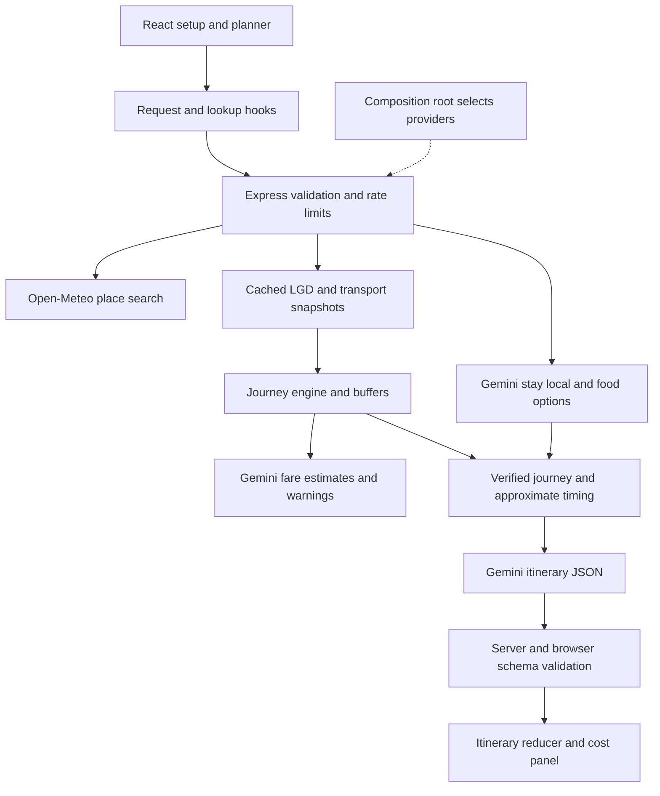

# Trip Planner

An India trip planner built with React and Express. Choose places and transport hubs, compare journeys from bundled transport snapshots, edit fare/stay/local/meal estimates, then generate an itinerary with Gemini. Each journey explains its evidence and buffers, and every fare remains an estimate.

## Quick start

Use Node.js 22.22.2+ in the 22.x line or 24.15.0+, and npm. These commands assume PowerShell and a fresh clone.

### Keyless demo

```powershell
npm install
Copy-Item .env.example .env
$env:MOCK = "demo"
npm start
```

Open [localhost:5173](http://localhost:5173). The header displays **Demo data**. Demo prices and itineraries are deterministic illustrations. Place search still uses Open-Meteo. During an outage, choose hubs from the bundled search.

### Live Gemini

Set the real key in your local .env, leave MOCK unset, and use the configured model.

```powershell
Remove-Item Env:MOCK -ErrorAction SilentlyContinue
npm start
```

The example model is `gemini-flash-lite-latest`. Latest aliases can change behavior over time. Express warns when live generation has no key. Keep the key in the server environment and keep .env ignored.

Vite defaults to port 5173 and proxies API requests to Express on 8787. Change PORT and VITE_DEV_PORT if needed, then restart both processes and reload the browser. Vite may choose another available port.

## Features

- State/district and destination pickers, nearby hubs and dataset-only hub search.
- Up to five routes with leg details, duration, transfers and dated evidence.
- Budget, Standard and Comfort fare tiers, manual edits and return/one-way estimates.
- Independent stay, local transport and food choices with a per-leg cost breakdown.
- Approximate arrival/leave-by timing in itinerary generation.
- Editable daily stops, cross-day dragging, keyboard move controls, undo and packing.
- Loading, cancellation, retry, empty states, request cooldowns and cached lookups.
- A visible demo badge and source attribution.

## Architecture and data flow



server/composition.js selects live/demo/fault adapters and dataset access. Routes parse requests and call services; the server calculates route structure and verifies journey IDs and hubs. Gemini receives computed leg facts for fares and verified trip context for itinerary generation. The browser's request IDs prevent stale results from replacing newer ones. [Architecture notes](docs/ARCHITECTURE.md)

## Scripts

| Command | Purpose |
| --- | --- |
| `npm start` / `npm run dev` | Start Vite and Express |
| `npm run start:prod` | Build and serve compressed production assets |
| `npm test` | Unit, UI, HTTP and characterization tests |
| `npm run typecheck` | Blocking production UI, shared and server checkJs |
| `npm run build` | Production frontend build |
| `npm run data:fetch` | Fetch source snapshots into ignored data/raw |
| `npm run data:build` | Build and validate processed snapshots |
| `npm run data:check` | Validate bundled data and print source counts |
| `npm audit` | Check known dependency advisories |

## Environment

| Variable | Purpose and default |
| --- | --- |
| GEMINI_API_KEY | Server-only key, empty in the example |
| GEMINI_MODEL | Defaults to gemini-flash-lite-latest |
| PORT | Express and Vite proxy target, 8787 |
| VITE_DEV_PORT | Requested Vite port, 5173 |
| MOCK | Unset for live generation, demo for keyless illustrations |
| MOCK_STAGE | Optional plan value to isolate generic faults to itinerary generation |

Health returns only `{ ok, mode }`, where mode is demo or live. It contains no credentials.

## Failure handling

Set MOCK in .env or the shell and restart. Add `MOCK_STAGE=plan` to isolate generic faults to the final itinerary stage.

| Mode/case | What the traveler sees and can do |
| --- | --- |
| demo | Demo data badge, illustrative options/fares and a requested-length plan |
| geo-down | Search unavailable, Retry and bundled hub fallback |
| geo-slow | Searching, then the same fallback after the provider deadline |
| geo-empty | No matches, refine the query or use a hub |
| fares-bad-json / fares-fail | Routes remain, edit prices or choose Estimate prices again |
| journeys-empty | A reason for the missing route and Change hubs |
| options-bad-shape / bad-shape | Invalid-response error after one browser retry, then Try again |
| bad-json | Invalid JSON error after one browser retry |
| options-empty / empty | Empty panel with Try again |
| fail | Server error and Try again |
| slow | Loading and Cancel, followed by a 30-second browser deadline |
| jitter | Loading with stale-response protection |
| wrong-days | A wrong count triggers one corrective browser retry and an error |
| 429 | Retry-After countdown, disabled action until it expires |
| Invalid key/access | Friendly authentication/configuration message |
| Missing model | A model configuration message |
| Provider quota / 5xx / timeout | Friendly quota, temporary-unavailable or timeout message |

Place/hub results are cached in page-session memory for ten minutes per normalized query. One page sends at most 24 uncached lookups per minute, below the server's shared 30-lookup limit. Other tabs and users sharing an IP can still reach that server limit. Planning and journey requests share 10 requests per minute. Health/other API routes have a separate 60-request limit. Requests have a 10 KB JSON cap.

## Costs and fare warnings

Travel sums each selected-tier one-way fare times paying travelers, or times ceil(travelers/4) for vehicle fares. The return toggle doubles travel. Children are charged as adults. Stay is room price × rooms × max(days-1,0). Meals, local transport and activities use the selected pricing basis. The optional contingency adds 10%.

Model fares must be finite, positive and at most 1e9. Unordered tiers are normalized. Unusual per-km estimates receive a non-blocking Check this estimate warning. Relative checks compare the same mode and tier within one response. Broad INR-only diagnostic bounds are documented in [fare references](docs/FARE_REFERENCE_RANGES.md). These ranges require human review and do not establish actual market prices.

## Data sources and licenses

Attribution covers Open-Meteo / GeoNames, OurAirports, datameet railways, OpenFlights and LGD. The committed data license record lists CC BY 4.0 location data, public-domain airport data, CC0 railway data, ODbL/DbCL flight data and GODL-India LGD data. The hosted free geocoder has non-commercial terms. [Sources and license details](docs/DATA_SOURCES.md)

## Known limitations

- Rail matches use a 2016 timetable snapshot, flight hints use 2014 data, and route coverage has regional gaps. [Data QA](docs/DATA_QA.md)
- Availability badges do not establish current service or seats. Verify on IRCTC or the airline/search site.
- Road distances, buffers, fares and activities are approximate. The app performs no currency conversion.
- Four departure buckets use 08:00, 13:00, 18:00 and 22:00 anchors. They are planning approximations.
- An in-progress browser cancellation can leave the server finishing an upstream request.
- Trip edits are held in memory. Reloading clears them. Optional persistence was not implemented.
- JSDOM axe checks do not establish full computed color contrast, assistive-technology behavior or physical-phone usability.
- The type check includes production UI but retains the project's strict:false JavaScript policy.
- Route plausibility, the diagnostic fare ranges, physical-phone checks and user authorship details require human review. [QA report](docs/QA_REPORT.md)

## Where to start reading the code

1. [App.jsx](src/App.jsx) for step state and screen composition; follow its useTripPlanner hook for lifecycle.
2. [TripForm.jsx](src/features/setup/TripForm.jsx) for setup and validation.
3. [useGenerate.js](src/hooks/useGenerate.js) for request lifecycle protections.
4. [shared/schemas.js](shared/schemas.js) for request contracts.
5. [server/app.js](server/app.js) for HTTP mounting; follow server/composition.js for provider selection.
6. [journeys/engine.js](server/journeys/engine.js) for route construction.
7. [costs.js](src/lib/costs.js) for cost arithmetic.
8. [itineraryReducer.js](src/itineraryReducer.js) for editing and undo.

## Verification and interview preparation

Final-structure checks passed 271 tests in 28 files on three consecutive clean-install runs, with passing typecheck/build and zero audit vulnerabilities. All 16 mock modes were checked in the browser and all six live cases eventually passed after provider retries. The full refactor adds 0.35% raw asset bytes, and startup timings vary; those acceptance limits are recorded rather than hidden.

[Baseline](docs/BASELINE.md) · [QA](docs/QA_REPORT.md) · [Refactor plan](docs/REFACTOR_PLAN.md) · [Interview guide](docs/INTERVIEW_GUIDE.md) · [Demo script](docs/DEMO_SCRIPT.md)

## AI usage and authorship

OpenAI Codex implemented and checked the requested repository changes. Its tools included shell/Git, Python PDF extraction, browser automation, Vitest/V8 coverage, axe, Babel source analysis, madge, jscpd and depcheck. Gemini supplies runtime estimates and itineraries.

An earlier README credited Google Antigravity for review and QA. **[USER CONFIRMATION REQUIRED — identify every AI tool you used, its contribution, and the code or reasoning you wrote or changed yourself.]** These authorship details are UNVERIFIED until confirmed.

## Time spent

**[USER TO FILL — actual time spent. No hours have been invented.]**
